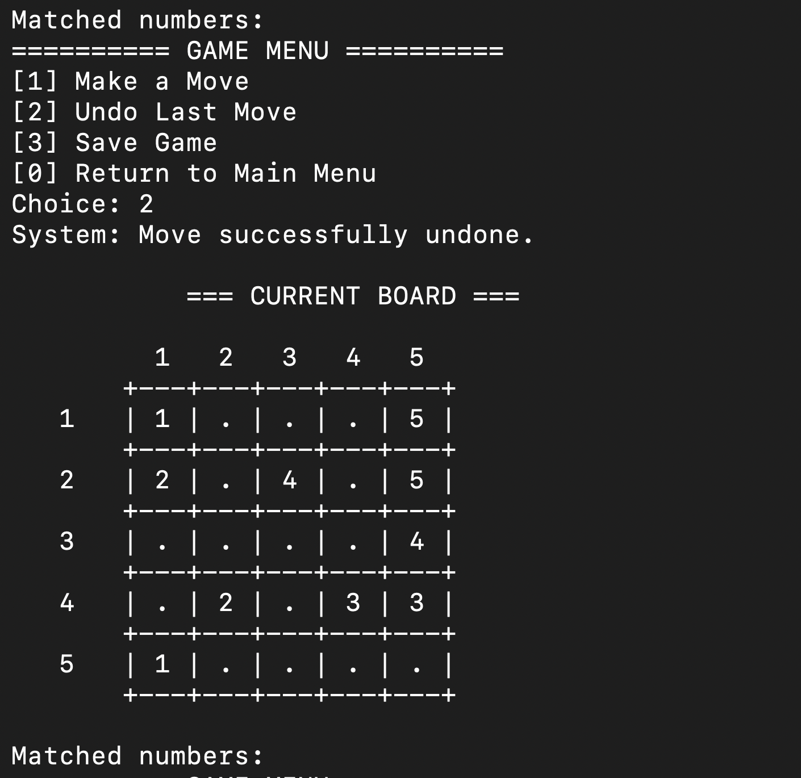

# Number Matching Game

English | [Türkçe](README.tr.md)

A terminal-based number matching and path-building puzzle written in C. Play manually or use the automatic solver to explore solutions through recursive backtracking.

Developed as a Structured Programming term project, the application combines dynamic memory management, recursion, a stack-based move history, and binary file operations.

<p align="center">
  
</p>

## Features

- **Two game modes:** Make moves manually or run the automatic solver.
- **Two board sources:** Generate a random board or load one from a text file.
- **Move validation:** Check board boundaries, movement direction, source cells, and path availability.
- **Undo:** Reverse the last move using a stack-based history.
- **Save and resume:** Save a session to a player-specific file and reload it from the main menu.
- **Player profiles:** Track best scores, completed games, and game history.
- **Scoring:** Calculate points from board size, elapsed time, undo count, game mode, and experience.

## Quick start

A C compiler such as GCC or Clang is required. No third-party libraries are needed. Run the following commands from the project directory.

### macOS / Linux

```sh
cc -std=c11 -Wall -Wextra number_matching.c -o number-matching
./number-matching
```

### Windows · MinGW / GCC

```powershell
gcc -std=c11 -Wall -Wextra number_matching.c -o number-matching.exe
.\number-matching.exe
```

> Board and save files are read and written relative to the current working directory. Run the application from the project root to access the sample board and keep saves in the same location.

## How to play

Connect pairs of matching numbers using horizontal and vertical paths, leaving no empty cells on the board.

1. Select `Create Random Matrix` or `Create Matrix From File` from the main menu.
2. Enter a username with at least 3 characters and no spaces.
3. Select `Manual Mode` or `Automatic Mode`.
4. For a random board, enter a size; the minimum is `3`. To load a board, enter a filename such as `sample-board.txt`.
5. In manual mode, select `Make a Move` and enter the source and target cells as `Row Col`. In-game coordinates are **1-based**.

Each move follows a single row or column; turning requires another move. Intermediate cells must be empty, and the target must be empty or contain the same number as the source. Paths belonging to different numbers cannot cross. Winning requires completing every match and filling every cell.

| Option | Manual mode | Automatic mode |
| --- | --- | --- |
| `1` | Make a move | Solve the board |
| `2` | Undo the last move | Save the game |
| `3` | Save the game | — |
| `0` | Save and return to the main menu | Save and return to the main menu |

To resume a session, select `Load Saved Game` from the main menu using the corresponding username.

## Board file format

Each line describes one cell:

```text
row column number
```

File coordinates are **0-based**. For example:

```text
1 0 1
5 5 1
2 0 2
6 6 2
```

The first two lines place the endpoints for `1`, and the next two place the endpoints for `2`. This snippet illustrates the format; it is not a complete puzzle. The board size is calculated as one more than the largest row or column index in the file. There is no separate size header.

The repository includes `sample-board.txt`. The filename does not determine the dimensions: its largest coordinate is `7`, so it produces an 8×8 board.

## Implementation

| Structure / component | Responsibility |
| --- | --- |
| `Board` | Dynamically allocated two-dimensional board |
| `Move` / `MoveStack` | Move data and undo history |
| `GameSession` | Board, mode, timing, score, and matching state |
| `Player` / `PlayerList` | Player profiles and completed games |
| `solvePathRecursive` | Recursive solution search and backtracking |
| `isValidMove` / `checkPathRecursive` | Move and path validation |

### Scoring

```text
score = (N² × 500 / (duration + undoCount × 5))
        × modeMultiplier × sourceMultiplier × (1 + completedGames × 0.02)
```

Duration is measured in seconds with a minimum of `1`. The mode multiplier is `1.0` for manual play and `0.05` for automatic play. The source multiplier is `1.0` for random boards and `0.8` for boards loaded from a file. The experience multiplier uses the number of games completed before the current game.

## Project structure

```text
.
├── number_matching.c  # Application source code
├── sample-board.txt   # Sample board coordinates
├── screenshots/       # Gameplay screenshots
├── .gitignore
├── README.md          # English documentation
└── README.tr.md       # Turkish documentation
```

The application creates `players.bin` and `<username>_save.bin` during use. Compiled executables and local save files are excluded from Git. Source code, the sample board, and screenshots are included in the repository.

## Known limitations

This version was developed as a term project. The automatic solver may take longer on larger boards. The file-loading function does not initialize its temporary matrix, so cells omitted from the input file may contain unexpected values. Input validation is also limited. Keep these behaviors in mind when preparing custom board files.
