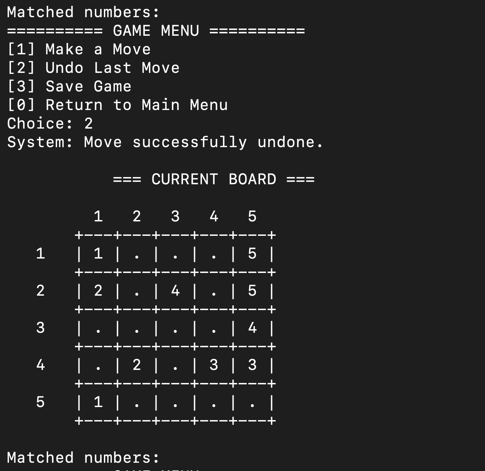
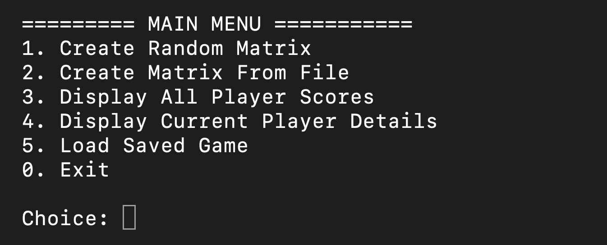
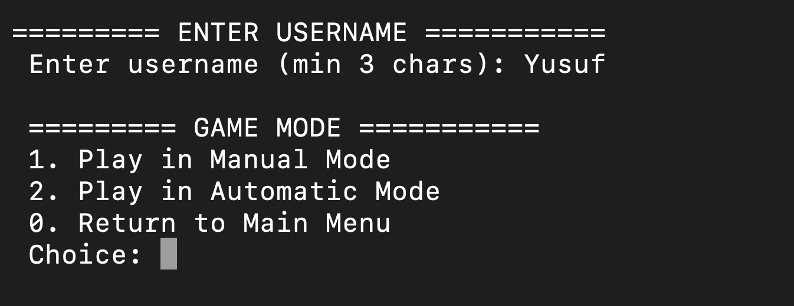
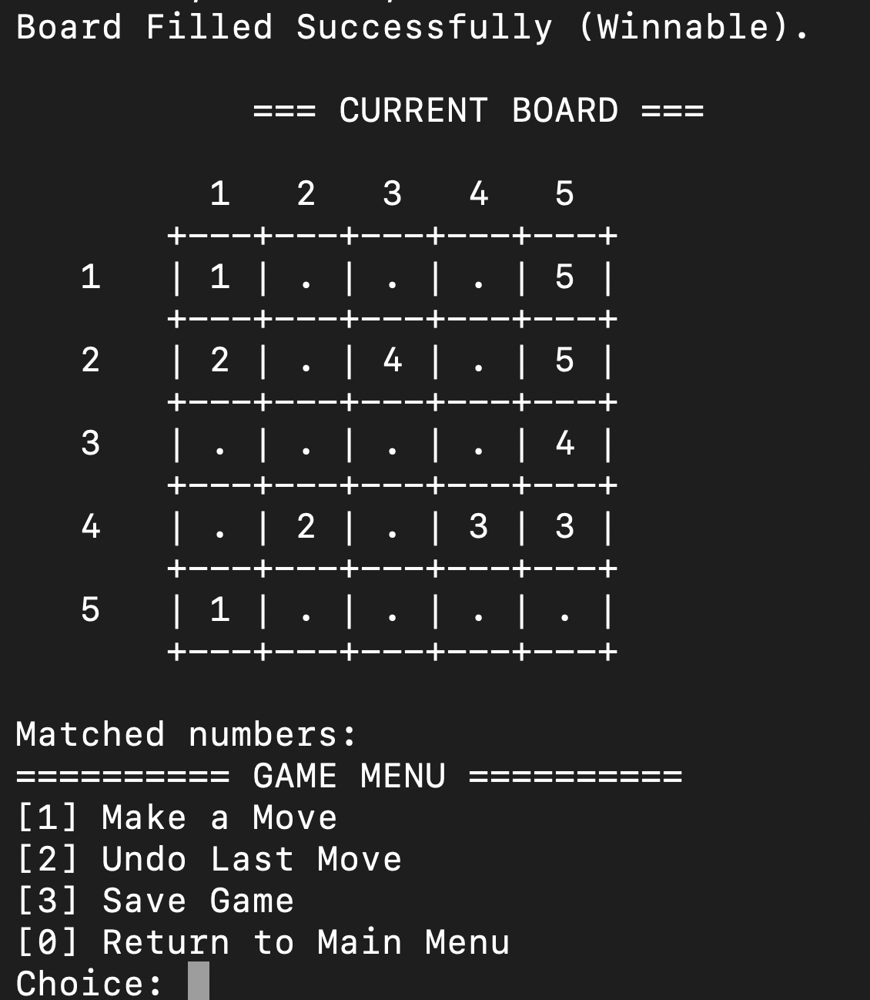
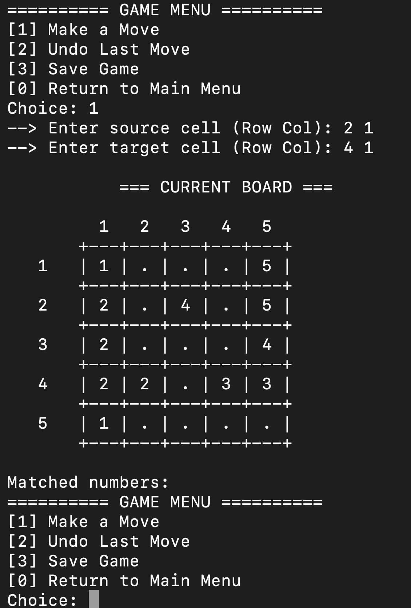
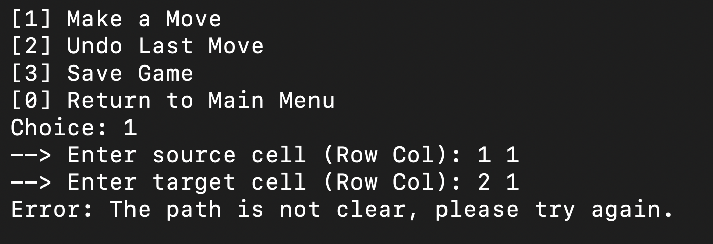
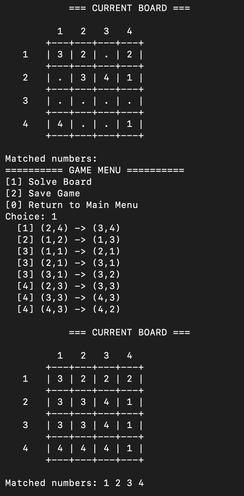
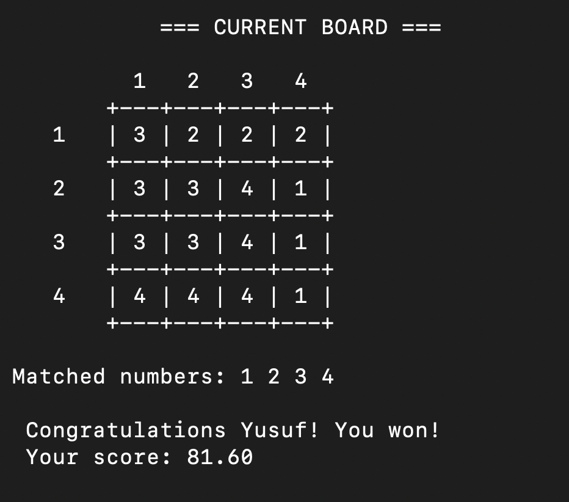
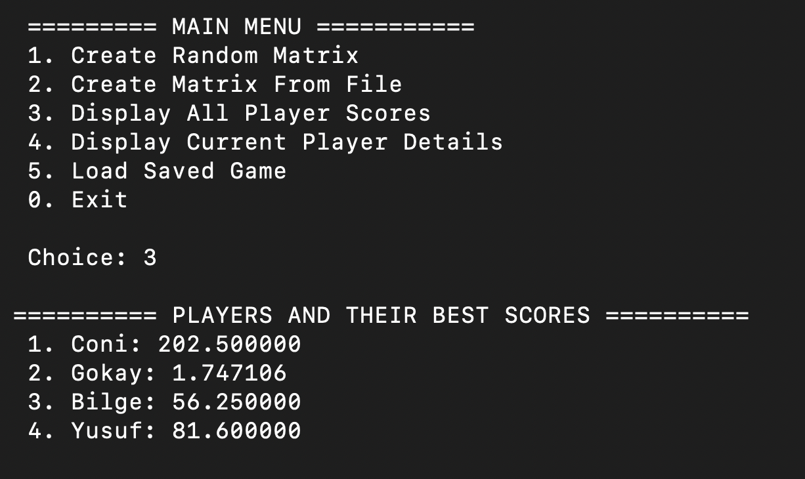
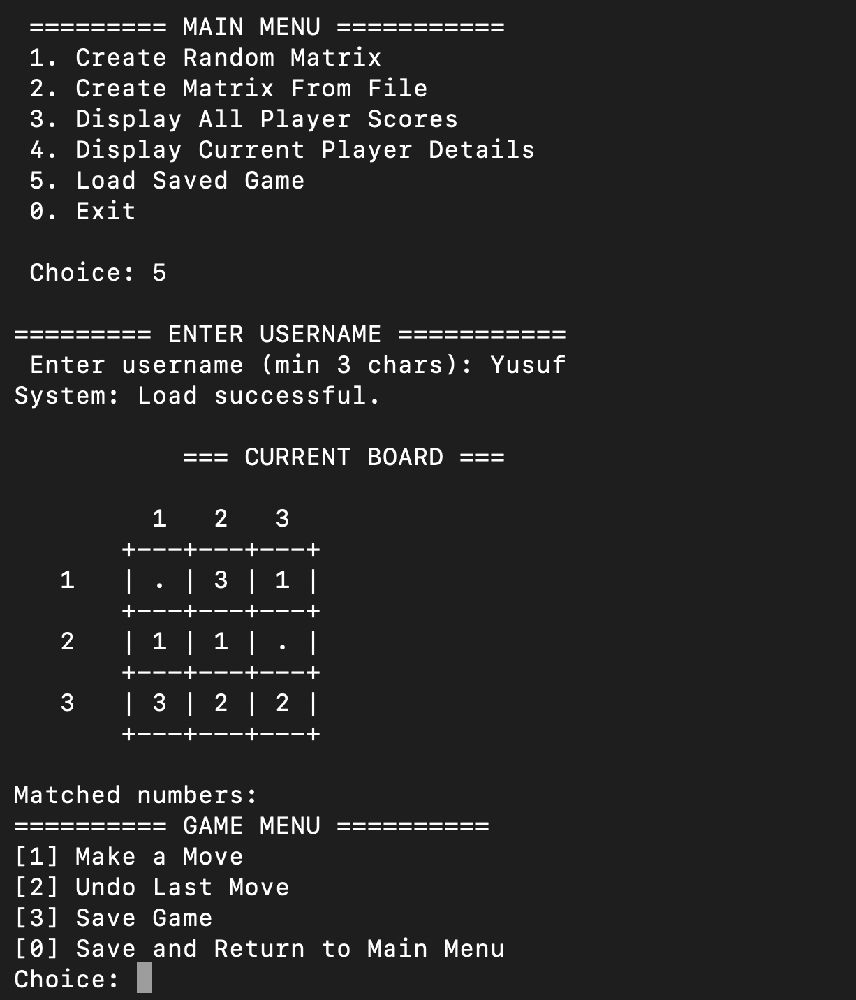

<div align="center">

# Number Matching Game

**Connect every pair, fill every cell — or let the recursive solver do it for you.**

[](https://en.cppreference.com/w/c/11)
[](#quick-start)
[](#implementation)
[](#quick-start)

**English** · [Türkçe](README.tr.md)



</div>

---

A terminal-based number matching and path-building puzzle written in C. Play manually, or use the automatic solver to explore solutions through **recursive backtracking**.

Developed as a **Structured Programming** term project, it combines dynamic memory management, recursion, a stack-based move history and binary file operations.

## Contents

- [Features](#features)
- [Quick start](#quick-start)
- [How to play](#how-to-play)
- [Board file format](#board-file-format)
- [Implementation](#implementation)
- [Screenshots](#screenshots)
- [Project structure](#project-structure)
- [Known limitations](#known-limitations)

## Features

| Feature | Description |
| --- | --- |
| **Two game modes** | Make moves manually or run the automatic solver |
| **Two board sources** | Generate a random board or load one from a text file |
| **Move validation** | Board boundaries, movement direction, source cells and path availability |
| **Undo** | Reverse the last move using a stack-based history |
| **Save and resume** | Save a session to a player-specific file and reload it from the main menu |
| **Player profiles** | Best scores, completed games and game history |
| **Scoring** | Points from board size, elapsed time, undo count, game mode and experience |

## Quick start

A C compiler such as GCC or Clang is required. No third-party libraries are needed.

<table>
<tr><th>macOS / Linux</th><th>Windows · MinGW / GCC</th></tr>
<tr>
<td>

```sh
cc -std=c11 -Wall -Wextra number_matching.c -o number-matching
./number-matching
```

</td>
<td>

```powershell
gcc -std=c11 -Wall -Wextra number_matching.c -o number-matching.exe
.\number-matching.exe
```

</td>
</tr>
</table>

> [!TIP]
> Board and save files are read and written relative to the current working directory. Run the app from the project root so it finds the sample board and keeps saves in one place.

## How to play

**Goal:** connect pairs of matching numbers using horizontal and vertical paths, leaving no empty cells on the board.

1. Select `Create Random Matrix` or `Create Matrix From File` from the main menu.
2. Enter a username with at least 3 characters and no spaces.
3. Select `Manual Mode` or `Automatic Mode`.
4. For a random board, enter a size (minimum `3`). To load a board, enter a filename such as `sample-board.txt`.
5. In manual mode, select `Make a Move` and enter the source and target cells as `Row Col`. In-game coordinates are **1-based**.

> [!IMPORTANT]
> Each move follows a single row or column — turning requires another move. Intermediate cells must be empty, and the target must be empty or contain the same number as the source. Paths of different numbers cannot cross. **You win when every pair is matched and every cell is filled.**

| Option | Manual mode | Automatic mode |
| :---: | --- | --- |
| `1` | Make a move | Solve the board |
| `2` | Undo the last move | Save the game |
| `3` | Save the game | — |
| `0` | Save and return to the main menu | Save and return to the main menu |

To resume a session, select `Load Saved Game` from the main menu with the same username.

## Board file format

Each line describes one cell:

```text
row column number
```

File coordinates are **0-based**. For example:

```text
1 0 1
5 5 1
2 0 2
6 6 2
```

The first two lines place the endpoints of `1`, the next two place the endpoints of `2`. (This snippet only illustrates the format; it is not a complete puzzle.) The board size is one more than the largest row or column index in the file — there is no separate size header.

The repository includes [`sample-board.txt`](sample-board.txt). Its largest coordinate is `7`, so it produces an **8×8** board.

## Implementation

| Structure / component | Responsibility |
| --- | --- |
| `Board` | Dynamically allocated two-dimensional board |
| `Move` / `MoveStack` | Move data and undo history |
| `GameSession` | Board, mode, timing, score and matching state |
| `Player` / `PlayerList` | Player profiles and completed games |
| `solvePathRecursive` | Recursive solution search and backtracking |
| `isValidMove` / `checkPathRecursive` | Move and path validation |

### Scoring

```text
score = (N² × 500 / (duration + undoCount × 5))
        × modeMultiplier × sourceMultiplier × (1 + completedGames × 0.02)
```

| Factor | Value |
| --- | --- |
| `duration` | Seconds, minimum `1` |
| `modeMultiplier` | `1.0` manual · `0.05` automatic |
| `sourceMultiplier` | `1.0` random board · `0.8` board loaded from file |
| `completedGames` | Games completed before the current one |

## Screenshots

<table>
  <tr>
    <td></td>
    <td></td>
  </tr>
  <tr>
    <td></td>
    <td></td>
  </tr>
</table>

<details>
<summary>More screenshots</summary>

<br>

<table>
  <tr>
    <td></td>
    <td></td>
  </tr>
  <tr>
    <td></td>
    <td></td>
  </tr>
  <tr>
    <td colspan="2"></td>
  </tr>
</table>

</details>

## Project structure

```text
.
├── number_matching.c  # Application source code
├── sample-board.txt   # Sample board coordinates
├── screenshots/       # Gameplay screenshots
├── .gitignore
├── README.md          # English documentation
└── README.tr.md       # Turkish documentation
```

The application creates `players.bin` and `<username>_save.bin` during use. Compiled executables and local save files are excluded from Git.

## Known limitations

This version was developed as a term project.

- The automatic solver may take longer on larger boards.
- The file-loading function does not initialize its temporary matrix, so cells omitted from the input file may contain unexpected values.
- Input validation is limited — keep this in mind when preparing custom board files.

---

<div align="center">

Made by [**Yusuf Emir Gökdoğan**](https://github.com/ygokdogan)

</div>
