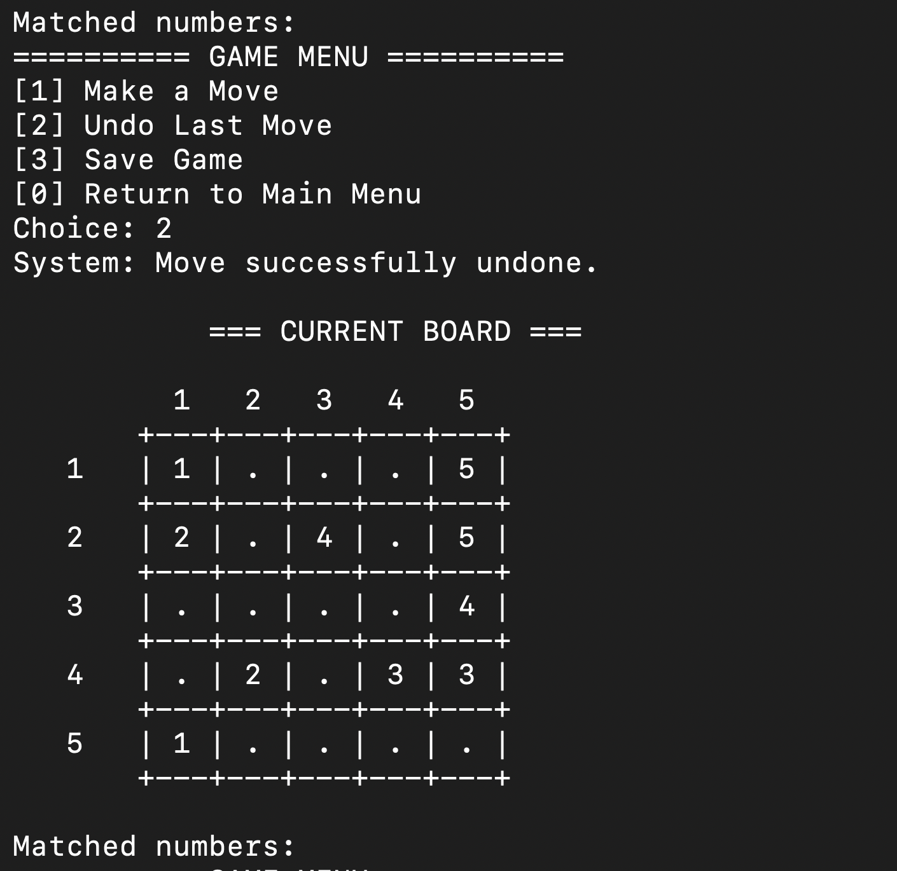

# Number Matching Game

[English](README.md) | Türkçe

C ile geliştirilmiş, terminal üzerinden oynanan bir sayı eşleştirme ve yol oluşturma oyunu. Manuel modda çözümü adım adım kurabilir veya otomatik modda özyinelemeli geri izleme (*recursive backtracking*) algoritmasının çözüm arayışını izleyebilirsin.

Yapısal Programlama dönem projesi kapsamında geliştirilen uygulama; dinamik bellek yönetimini, özyinelemeyi, yığın veri yapısını ve ikili dosya işlemlerini tek bir oyun akışında bir araya getirir.

<p align="center">
  
</p>

## Özellikler

- **İki oyun modu:** Hamleleri kendin yap veya otomatik çözücüyü çalıştır.
- **İki tahta kaynağı:** Rastgele tahta üret ya da metin dosyasından yükle.
- **Hamle kontrolü:** Sınır, yön, kaynak hücre ve yol uygunluğu denetimleri.
- **Geri alma:** Yığın tabanlı hamle geçmişiyle son hamleyi geri al.
- **Kaydet ve devam et:** Oyunu kullanıcıya özel dosyada sakla, ana menüden yeniden yükle.
- **Oyuncu profilleri:** En iyi skor, tamamlanan oyun sayısı ve oyun geçmişi.
- **Skor sistemi:** Tahta boyutu, süre, geri alma sayısı, oyun modu ve deneyime göre puanlama.

## Hızlı başlangıç

GCC veya Clang gibi bir C derleyicisi yeterlidir; üçüncü taraf kütüphane gerekmez. Aşağıdaki komutları proje klasöründe çalıştır.

### macOS / Linux

```sh
cc -std=c11 -Wall -Wextra number_matching.c -o number-matching
./number-matching
```

### Windows · MinGW / GCC

```powershell
gcc -std=c11 -Wall -Wextra number_matching.c -o number-matching.exe
.\number-matching.exe
```

> Uygulama, tahta ve kayıt dosyalarını çalıştırıldığı klasöre göre okur ve yazar. Örnek dosyayı kullanmak ve kayıtları aynı yerde tutmak için proje kökünden çalıştır.

## Nasıl oynanır?

Amaç, aynı değere sahip sayı çiftlerini yatay ve dikey yollarla birleştirmek ve tahtada boş hücre bırakmamaktır.

1. Ana menüden `Create Random Matrix` veya `Create Matrix From File` seçeneğini seç.
2. En az 3 karakterli, boşluk içermeyen bir kullanıcı adı gir.
3. `Manual Mode` veya `Automatic Mode` seç.
4. Rastgele oyun için tahta boyutunu gir; minimum boyut `3` olur. Dosyadan oyun için örneğin `sample-board.txt` yaz.
5. Manuel modda `Make a Move` ile kaynak ve hedef hücreyi `Row Col` biçiminde gir. Oyun içi satır ve sütun numaraları **1'den başlar**.

Her hamle aynı satır veya sütun boyunca ilerler; dönüş yapmak için yeni bir hamle gerekir. Yol üzerindeki ara hücreler boş olmalı, hedef hücre boş veya kaynakla aynı değerde olmalıdır. Farklı sayıların yolları kesişemez. Kazanmak için tüm eşleşmelerin tamamlanması ve bütün hücrelerin doldurulması gerekir.

| İşlem | Manuel mod | Otomatik mod |
| --- | --- | --- |
| `1` | Hamle yap | Tahtayı çöz |
| `2` | Son hamleyi geri al | Oyunu kaydet |
| `3` | Oyunu kaydet | — |
| `0` | Kaydet ve ana menüye dön | Kaydet ve ana menüye dön |

Kaydedilen oyuna ana menüdeki `Load Saved Game` seçeneğinden, ilgili kullanıcı adıyla devam edebilirsin.

## Tahta dosyası formatı

Her satır bir hücreyi tanımlar:

```text
satır sütun sayı
```

Dosya koordinatları **0'dan başlar**. Örneğin:

```text
1 0 1
5 5 1
2 0 2
6 6 2
```

Burada ilk iki satır `1` sayısının iki ucunu, sonraki iki satır `2` sayısının iki ucunu yerleştirir. Bu kesit yalnızca biçimi gösterir; tam bir oyun tahtası değildir. Tahta boyutu, dosyadaki en büyük satır veya sütun indeksinin bir fazlasından hesaplanır; ayrı bir boyut başlığı bulunmaz.

Depodaki `sample-board.txt` örnek koordinat dosyasıdır. Dosya adı boyutu belirlemez: mevcut içerikte en büyük indeks `7` olduğu için tahta 8×8 olarak oluşturulur.

## Teknik yapı

| Yapı / bileşen | Sorumluluk |
| --- | --- |
| `Board` | Dinamik olarak ayrılan iki boyutlu oyun tahtası |
| `Move` / `MoveStack` | Hamle bilgileri ve geri alma geçmişi |
| `GameSession` | Tahta, mod, süre, skor ve eşleşme durumu |
| `Player` / `PlayerList` | Oyuncu profilleri ve tamamlanan oyunlar |
| `solvePathRecursive` | Özyinelemeli çözüm arama ve geri izleme |
| `isValidMove` / `checkPathRecursive` | Hamle ve yol uygunluğu kontrolü |

### Puanlama

```text
skor = (N² × 500 / (süre + geriAlmaSayısı × 5))
       × modÇarpanı × kaynakÇarpanı × (1 + tamamlananOyunSayısı × 0.02)
```

Süre saniye cinsindendir ve en az `1` kabul edilir. Mod çarpanı manuel oyunda `1.0`, otomatik oyunda `0.05`; kaynak çarpanı rastgele tahtada `1.0`, dosyadan yüklenen tahtada `0.8` olur. Deneyim çarpanında mevcut oyundan önce tamamlanan oyun sayısı kullanılır.

## Dosya düzeni

```text
.
├── number_matching.c  # Uygulamanın kaynak kodu
├── sample-board.txt   # Örnek tahta koordinatları
├── screenshots/       # Oyun ekran görüntüleri
├── .gitignore
├── README.md          # İngilizce dokümantasyon
└── README.tr.md       # Türkçe dokümantasyon
```

Çalıştırma sırasında `players.bin` ve `<kullanıcı_adı>_save.bin` dosyaları oluşur. Derlenmiş programlar ve yerel oyun kayıtları Git kapsamı dışında tutulur. Kaynak kod, örnek tahta ve ekran görüntüleri depoya dahildir.

## Mevcut sınırlamalar

Bu sürüm bir dönem projesidir. Otomatik çözücünün arama süresi büyük tahtalarda artabilir. Dosyadan tahta okuma işlevinde, dosyada belirtilmeyen hücreler için kullanılan geçici matris sıfırlanmadığından beklenmeyen hücre değerleri oluşabilir; giriş doğrulaması da sınırlıdır. Özel tahta dosyaları hazırlanırken bu davranış dikkate alınmalıdır.
